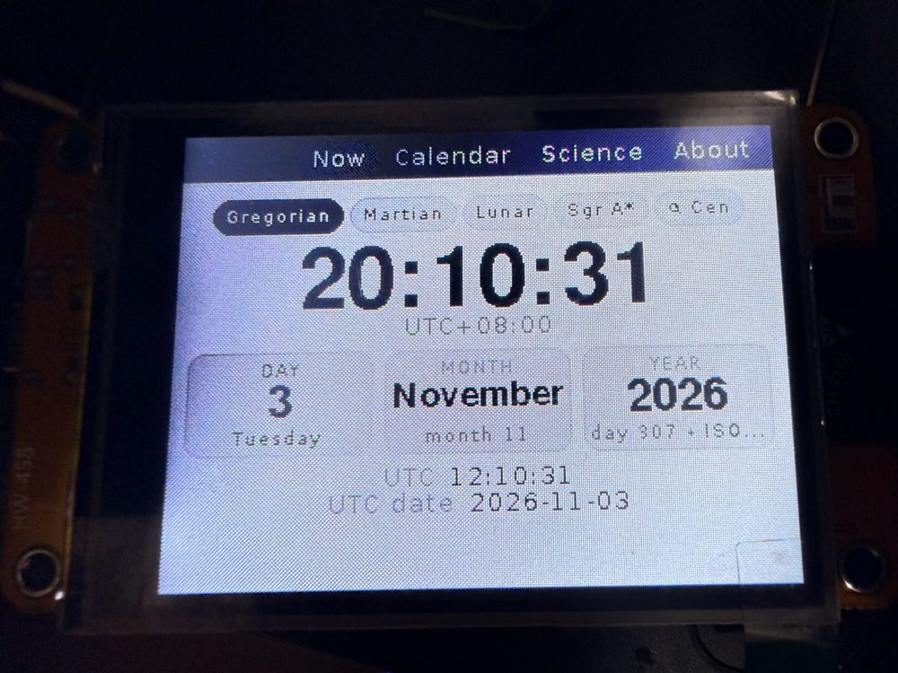
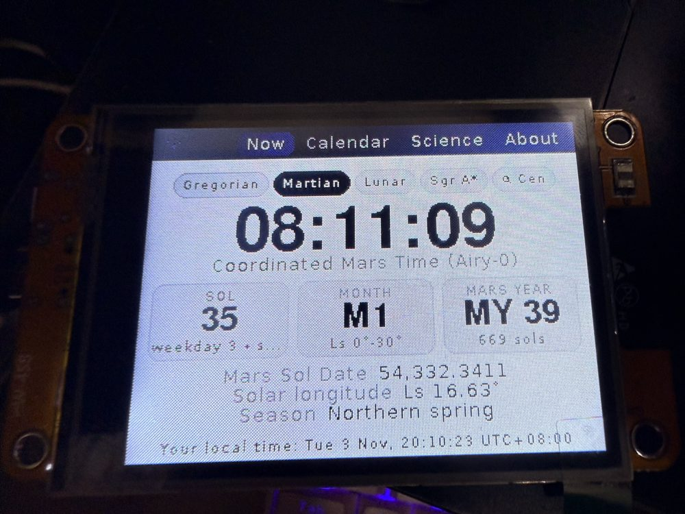
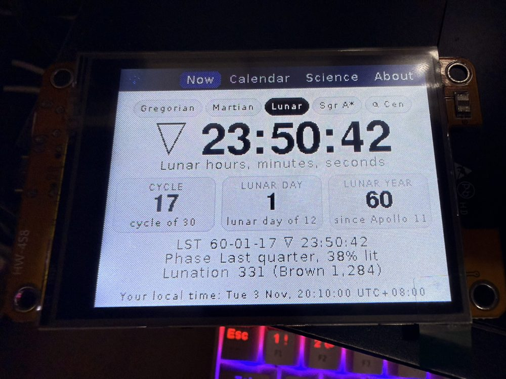
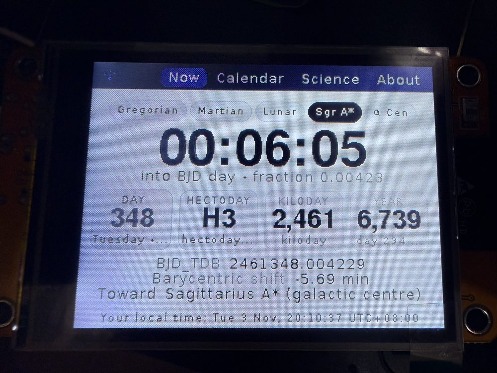
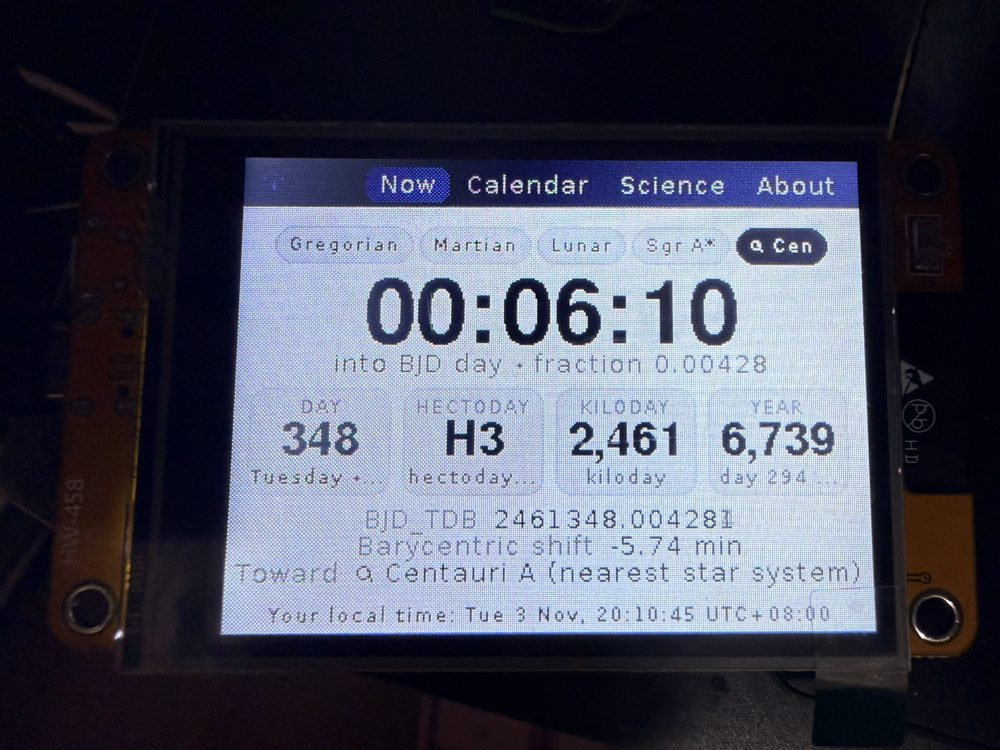

# Astrochronist Calendar for the Cheap Yellow Display

[](LICENSE)
[](https://platformio.org/)
[](https://github.com/witnessmenow/ESP32-Cheap-Yellow-Display)
[](https://docs.espressif.com/projects/arduino-esp32/)
[](src)
[](https://eagnespuerto.github.io/astrochronist-calendar/)
[](https://ko-fi.com/eagnespuerto)
[](https://linktr.ee/soitsagnes)

The [Astrochronist Calendar](https://github.com/eagnespuerto/astrochronist-calendar) as firmware for the ESP32-2432S028R "Cheap Yellow Display": a 320×240 touch screen that keeps Gregorian, Martian, Lunar Standard Time and barycentric (BJD) time, set from the internet over Wi-Fi.

It has the website's four tabs, Now, Calendar, Science and About, laid out for the small screen. The NASA photos and blur effects are left out, so the pages use flat colours.

## On the board

| Gregorian | Martian | Lunar Standard Time |
|---|---|---|
|  |  |  |

| BJD toward Sagittarius A* | BJD toward α Centauri |
|---|---|
|  |  |

## What's on each tab

- **Now**: a big clock for one system at a time, with day, month and year chips and the extra numbers from the site (Mars Sol Date, solar longitude, lunar phase, barycentric shift).
- **Calendar**: the Mars-calendar card layout for every system. Tap a day to convert it into every other calendar. **Today** jumps to the current day, and tapping the bar of month widths scrolls to that month. Drag to scroll.
- **Science**: live time scales, BJD, Mars and Moon cards, the exact Martian month boundaries for any Mars Year, and the transit and eclipse planner with its sample target.
- **About**: what astrochronism is, the systems, accuracy and credits, plus the device's clock and Wi-Fi status.

The website's "Go to" box and the planner's text fields need a keyboard, so they are not on the board. The planner keeps its two checkboxes, including "Show on calendar".

The time math is a direct port of the site's `js/time/*.js` (Mars24 / Allison and McEwen 2000 for Mars, Kenneth L. Lee's Lunar Standard Time, and a low-precision barycentric correction good to about ±2 s).

## Prebuilt firmware

Each [release](https://github.com/eagnespuerto/astrochronist-cyd/releases) has `astrochronist-cyd-<version>-merged.bin`, a single image to flash at offset `0x0`:

```bash
esptool.py --chip esp32 write_flash 0x0 astrochronist-cyd-v1.0.0-merged.bin
```

Release builds have no Wi-Fi networks in them, so set the clock over USB with `python tools/cyd.py sync` (it keeps time while powered). Build it yourself, below, to add your networks.

## Build and flash

You need [PlatformIO](https://platformio.org/) (`pip install platformio`).

1. Copy `src/secrets.example.h` to `src/secrets.h` and list your Wi-Fi networks. The board tries them in order and syncs the time over NTP.
2. Plug in the board and flash it:

   ```bash
   pio run -t upload
   ```

3. On first boot the screen asks you to tap four red crosses to calibrate touch. The result is saved on the board.

The local time zone defaults to UTC+08:00. Set it from your PC with `python tools/cyd.py sync`, which also sets the clock over USB if you have no Wi-Fi.

## Display variants

Cheap Yellow Displays ship with either an ILI9341 or an ST7789 panel, and some don't report which. If the screen shows stripes, is upside down, or has inverted colours, change the setting over USB. Each setting is saved on the board and survives reflashing.

| Command | Effect |
|---|---|
| `D1` / `D2` / `D0` | Force ILI9341 / force ST7789 / auto-detect |
| `R` | Rotate the screen 180° |
| `I` | Invert colours |
| `X` | Redo the touch calibration |

Send them with `python tools/cyd.py cmd D2` (set `CYD_PORT` if your board isn't on `COM13`).

## Serial tools

`tools/cyd.py` talks to the board at 921600 baud:

```bash
python tools/cyd.py shot screen.png
```

saves a screenshot straight from the frame buffer. `cmd "N1"` switches tab, `cmd "P 160 120"` taps a point, `cmd "S 200"` scrolls, and `cmd "?"` prints the clock and Wi-Fi status.

## Licence

MIT. Made by Ella Agnes Puerto.
